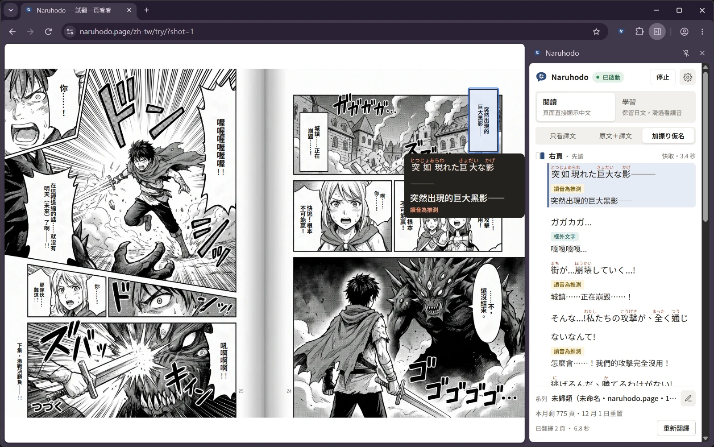
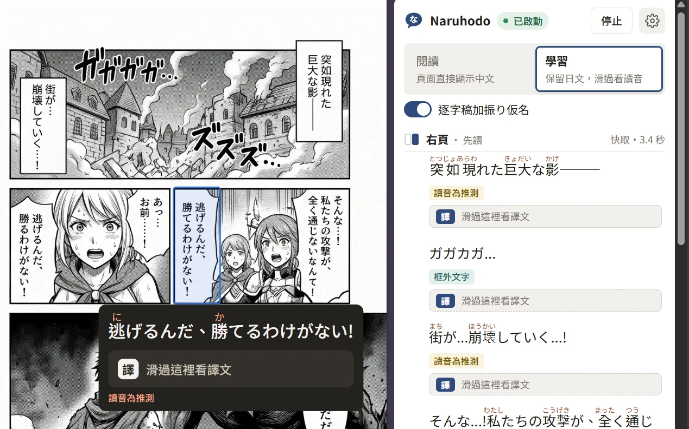

# Naruhodo

一個 Chrome 外掛：把畫面上正在看的日文漫畫，原地翻成繁體中文，並在 side panel 列出原文、讀音（振り仮名）與譯文對照，可以邊看漫畫邊學日文。

已在每頁一個 canvas 的漫畫網站與電子書閱讀器上驗證，外掛不針對特定網站寫規則，理論上一般網頁上的漫畫圖片也能用。



## 功能

- **原地翻譯**：點工具列圖示（或按 `Alt+Shift+M`）後，外掛會找出畫面上的漫畫 Page，把譯文直接覆蓋在對話框上；翻頁或捲動時自動翻新出現的 Page。
- **side panel 逐字稿**：依閱讀順序列出每一句的原文、讀音與譯文；滑鼠移到頁面上的對話框，side panel 會同步標示對應的句子。可以切換顯示層級：只看譯文、原文＋譯文、加振り仮名（預設）、只看日文。
- **閱讀／學習**：side panel 上方可以切換頁面要怎麼顯示。「閱讀」（預設）把對話框直接換成譯文；「學習」保留日文原稿，滑鼠移到句子上會先看到原文與讀音，再移到「譯」區塊才揭露譯文，適合先自己讀讀看再對答案。

  
- **跨頁（Spread）**：兩頁並排顯示時會自動切成兩個 Page 各自翻譯。
- **作品筆記（Series Notes）**：翻譯後會在背景累積角色名字與專有名詞，讓同一部作品前後翻譯一致；角色的自稱與說話方式由你在 side panel 填寫，也可以檢視與修正其他條目。
- **快取**：翻過的 Page 會存起來，重看同一頁不會再花錢呼叫 API。
- **匯出／匯入**：把作品、筆記與翻譯快取匯出成 JSON，在兩台電腦之間搬移（不含 API key）。

用語（Series、Page、Balloon 等）的定義見 [GLOSSARY.md](GLOSSARY.md)。

### 運作方式（簡述）

文字偵測與 OCR 都在你的電腦上跑（[onnxruntime-web](https://onnxruntime.ai/)，有 WebGPU 就用 WebGPU，沒有就退回 wasm），只有辨識出來的**文字**會送去用 Claude 做讀音與翻譯，圖片與網址都不會送出。每頁大約幾秒鐘。

翻譯有兩種用法，在 side panel 的 ⚙ →「設定」→「翻譯方式」隨時切換：

- **內建翻譯**（預設）：用 email 註冊帳號就能翻譯，新帳號有 50 頁免費額度，不用輸入付款資料。用完之後訂閱（年繳 US$20，每月 800 頁，由 Paddle 處理付款）。文字經過 Naruhodo 的服務交給 Anthropic 翻譯，服務不保存這些文字。
- **自備金鑰**：輸入你自己的 [Claude API key](https://console.anthropic.com/)，文字直接從你的瀏覽器送到 Anthropic，費用由你的 Anthropic 帳戶支付（用 Claude Haiku 每頁不到一美分），不用註冊帳號。

兩種方式送出與保存的資料見 [隱私權政策](PRIVACY.md)。

外掛只在你點圖示的那個分頁上作用（`activeTab` 權限），不會在背景讀取其他網站。

## 安裝

目前還沒有上架 Chrome Web Store，要從 GitHub Releases 下載後手動載入。

### 需要的東西

- Chrome 116 以上
- 一個收得到信的 email（內建翻譯），或一組 [Claude API key](https://console.anthropic.com/)（自備金鑰）。兩個都沒有也能用，但只會顯示原文與讀音，不會翻譯

### 1. 下載

下載最新版的 [naruhodo.zip](https://github.com/yurenju/naruhodo-manga-translator/releases/latest/download/naruhodo.zip)（各版本的更新內容見 [Releases](https://github.com/yurenju/naruhodo-manga-translator/releases)），解壓縮到一個固定的資料夾，例如 `文件/naruhodo`。

這個資料夾之後不要搬動或刪除：Chrome 是直接從這裡載入外掛的，換了位置就會被當成另一個外掛，設定、作品筆記與翻譯快取都會看不到。

### 2. 在 Chrome 載入

1. 在網址列打開 `chrome://extensions`。
2. 打開右上角的「開發人員模式」（Developer mode）。
3. 按「載入未封裝項目」（Load unpacked），選擇剛剛解壓縮的資料夾（裡面要直接看得到 `manifest.json`）。
4. 建議把 Naruhodo 釘選到工具列，之後比較好點。

### 3. 設定翻譯方式

第一次載入時會自動打開設定頁：

- **內建翻譯**：按「開始設定」，輸入 email、按「同意並寄送驗證碼」，再輸入信裡的 6 位數驗證碼，就有 50 頁免費額度。之後可以在同一頁或 side panel 的設定裡訂閱。
- **自備金鑰**：按設定頁下方的「使用自備金鑰」，貼上 Claude API key。key 只存在這台電腦的外掛裡，不會交給網頁，也不會出現在匯出檔。建議在 Anthropic Console 為這個外掛建立專用的 key，並替它的 workspace 設定花費上限。

之後要換方式、登出、刪除帳號或改 key，都在 side panel 右上角的 ⚙ →「設定」。

### 更新到新版

1. 保險起見，先在 side panel 用「匯出」備份作品、筆記與翻譯快取。
2. 下載最新版的 [naruhodo.zip](https://github.com/yurenju/naruhodo-manga-translator/releases/latest/download/naruhodo.zip)，**解壓縮覆蓋到原本的同一個資料夾**。
3. 到 `chrome://extensions` 按外掛卡片上的重新載入按鈕。

一定要覆蓋同一個資料夾：解壓縮到新的資料夾再載入，Chrome 會當成另一個外掛，API key、筆記與快取都要重新設定或從備份匯入。這個外掛以前叫 Manga Translator，如果當初解壓縮到 `manga-translator` 之類的資料夾，更新時一樣覆蓋到那個資料夾，不用改名。

## 使用

1. 打開漫畫網站，翻到要看的那一話。
2. 點工具列圖示（或按 `Alt+Shift+M`）。side panel 會打開，畫面上的 Page 開始翻譯。
3. 照平常的方式翻頁或捲動，新出現的 Page 會自動翻譯。如果不想自動翻譯，可以在 side panel 關掉「自動翻譯」，改成需要時按「翻譯此頁」。

第一次使用時會從 Hugging Face 下載 OCR 模型，需要等一下；下載完會存在外掛裡，之後不用再下載。

## 開發

### 從原始碼建置

需要 [Node.js](https://nodejs.org/) 24 以上（建置腳本是直接用 Node 執行 TypeScript）。

```bash
git clone https://github.com/yurenju/naruhodo-manga-translator.git
```

```bash
cd naruhodo-manga-translator
```

```bash
npm install
```

```bash
npm run build
```

建置完成後，外掛會輸出在 `dist/prod/` 資料夾，照[安裝](#2-在-chrome-載入)的方式用「載入未封裝項目」選這個資料夾即可。之後更新程式碼（例如 `git pull`）時，重新跑一次 `npm run build`，再到 `chrome://extensions` 按重新載入。

### 常用指令

| 指令 | 用途 |
| --- | --- |
| `npm run build` | 正式 build，輸出到 `dist/prod/` |
| `npm run typecheck` | TypeScript 型別檢查 |
| `npm test` | 單元測試（Vitest） |
| `npm run test:browser` | 用 mock 漫畫網站跑的 browser test（Playwright；OCR 重播錄好的結果，不跑模型） |
| `npm run e2e` | 少數主要流程跑真的 OCR 模型（改到 OCR／流水線、或開整合 PR 前才跑） |
| `npm run debug:chrome` | 開一個載入 debug build 的 Chrome，並記錄整個流水線的 trace |
| `npm run site:dev` | 產品網站（`site/`，Astro）的開發伺服器，`http://localhost:4321`；checkout 頁需要 `site/.env.local` 的 `PUBLIC_PADDLE_CLIENT_TOKEN`、`PUBLIC_PADDLE_ENVIRONMENT`（從 Paddle sandbox 設定的 `PADDLE_CLIENT_TOKEN`、`PADDLE_ENVIRONMENT` 複製） |
| `npm run site:build` | 產品網站的靜態檔，輸出到 `site/dist/` |
| `bash scripts/paddle-sandbox-wizard.sh` | 一步一步設定 Paddle sandbox（API key、price、webhook），值存在 repo 外的 `~/.config/naruhodo/paddle-sandbox.env` |
| `bash scripts/production-wizard.sh` | 一步一步開通 production（Cloudflare token、D1、第一次部署、Anthropic、Resend、Paddle live），live 的 key 只送到 Cloudflare 的 Worker secrets（ADR 0008） |
| `bash scripts/cws-service-account-wizard.sh` | 一步一步設定 release 自動上傳 Chrome Web Store 用的 service account（GCP、GitHub secret `CWS_SERVICE_ACCOUNT_KEY`、Dashboard），最後用 API 驗證；換 key 時重跑 |
| `node scripts/paddle-tunnel.ts` | 開 cloudflared tunnel，讓 Paddle sandbox 的 webhook 送到本機 `wrangler dev`（`--echo`：Worker 還沒跑時只驗簽章） |

各層測試怎麼分見 [docs/agents/testing.md](docs/agents/testing.md)，真實網站除錯見 [docs/agents/real-site-debugging.md](docs/agents/real-site-debugging.md)，架構決策見 [docs/adr/](docs/adr/)，程式碼規範見 [CODING_STANDARDS.md](CODING_STANDARDS.md)。

### 發布新版本

到 GitHub 的 Actions 頁面選 **Release** → **Run workflow**（branch 選 `main`）：

- `bump`：選 `patch`／`minor`／`major`，自動算出下一個版本號（預設 `patch`）。
- `version`：想指定版本號時才填，例如 `0.2.0`，必須比目前版本大；有填就忽略 `bump`。

workflow 會先跑型別檢查與單元測試，通過後更新 `package.json` 的版本號、commit 回 `main` 並打 tag，再建立 GitHub Release，附上 `naruhodo.zip`。版本號只寫在 `package.json`，`manifest.json` 的版本是建置時從這裡讀的。

## 授權

[MIT](LICENSE)
